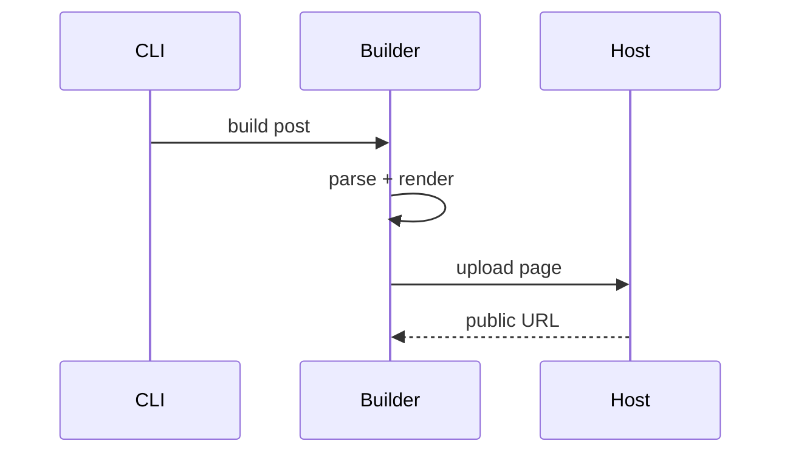

# Creating branches, commits and PRs

The repo's `CONTRIBUTING.md` / `CLAUDE.md` / `AGENTS.md`, if present, wins over this skill wherever they disagree.

## Before creating anything

- Confirm the working tree is in the state you want committed.
- Run `git branch -a` and `gh pr list --state all` to check whether a branch or PR for this work already exists. Don't create a duplicate.
- Never push a branch or run `gh pr create` without the user's explicit go-ahead. Creating a branch locally and committing is fine; pushing and opening the PR is the step to confirm first.
- Never commit directly on the default branch. Branch first.
- Base branch: the repo's default branch (`gh repo view --json defaultBranchRef --jq .defaultBranchRef.name`), unless the repo documents another PR base.
- If there is an issue/ticket, read it for the Why (use whatever tracker tool is available). If it can't be fetched, ask the user rather than inventing motivation.

## Branch naming

```
<type>/<short-kebab-description>
<type>/<TICKET>-<short-kebab-description>     # when a ticket exists
```

Examples: `feat/add-order-repository`, `fix/PROJ-123-null-pointer-on-refund`

- `type` is one of the Conventional Commit types below, matching the main change.
- Ticket key, if any, is copied exactly as given (uppercase, no typos in the prefix). No ticket: leave it out, don't invent one.
- Description is a few kebab-case words, not the whole title.
- If the repo prefixes branches with the author handle (`<handle>/…`), follow that.

## Commit and PR title

[Conventional Commits](https://www.conventionalcommits.org/):

```
<type>(<optional scope>): <description>
<type>(<optional scope>)!: <description>      # breaking change
```

Example: `feat(orders): add repository for order persistence`

- Types: `feat`, `fix`, `docs`, `style`, `refactor`, `perf`, `test`, `build`, `ci`, `chore`, `revert`.
- Description: imperative mood, lowercase start, no trailing period, about 50 characters. Say what the change does, not how.
- Scope: the package, module or area touched. Omit it when the change is cross-cutting.
- Reference the ticket in the footer (`Refs: PROJ-123`, or `Closes #123`), not in the subject, unless the repo's tooling needs it in the subject.
- Breaking change: add `!` and a `BREAKING CHANGE: <what breaks and how to migrate>` footer.
- Body (optional): blank line after the subject, then the why, wrapped at ~72 columns.
- Use the same line for the commit subject and the PR title. For squash-merge repos the PR title becomes the commit on the default branch, so it must be valid on its own.
- End commit messages with any attribution trailer the session's instructions require (for example `Co-Authored-By`).

## PR body

Fill this template. Don't leave HTML comments or empty sections in the output.

```
<issue link, if any>

## Why?

<one or two sentences on the motivation>

## How?

* <bullet per notable implementation change>

## Merge Danger

**Door:** <one-way or two-way>

<optional: description>

**Blast Radius:** <one-word description>
```

## Sections

### Why

One or two sentences on the motivation, taken from the ticket or the user.

### How

- Read the ticket and any relevant task artifacts.
- Read the complete PR diff and enough surrounding code to understand behavior and ownership.
- Add a short outline depending on the amount and complexity of changes. For very small and clear changes, skip it.

#### Outline description

Choose the most helpful variant.

- Show file responsibility or a broad refactor as a shallow file tree:

```text
internal/
├── parse/    # Markdown file → post model
├── render/   # post model → HTML page
└── publish/  # uploads the rendered page to the host
```

- Show component interaction, control flow, or data flow with Mermaid:



- Use `diff` when the point is what changes and the surrounding shape already exists. Match the diff shape to the topic.

For a file-layout change:

```diff
 internal/render/
 ├── page.go
+├── toc.go           # table of contents per page
 └── page_test.go
```

For a call-tree change:

```diff
 buildPage
   parseFrontMatter
   renderBody
     highlightCode
     resolveLinks
+    addTableOfContents
```

For a state or control-flow change:

```diff
 func publish(post *Post) error {
-	if post.Draft {
+	if post.Draft || post.PublishAt.After(time.Now()) {
 		return nil
 	}
```

- Show the whole block when most of it is new, when omitted context would hide ownership or order, or when the reader needs a copyable target shape:

```go
func findPost(posts []Post, slug string) (Post, bool) {
	for _, post := range posts {
		if post.Slug == slug {
			return post, true
		}
	}

	return Post{}, false
}
```

#### Guidance

Place each visual next to the short text it supports. Keep only the calls, files, props, states, and boundaries needed to answer the reader's question. Use one or several of these as fits; it is unlikely you will use all of them. Don't overwhelm the reader.

### Merge Danger

Describe whether it's a one-way or two-way door. You can walk back through two-way doors, but not one-way doors. A PR that is cheap to roll back is lower risk. Destructive actions and hard-to-reverse decisions (migrations that drop data, wire-format changes, deleted public APIs) are one-way doors.

Blast radius is the scope of impact if the change is wrong: broken consumers, data loss, layout shift, and so on. Consider all possibilities.

## Footer

End the PR body with any PR attribution line the session's instructions require.

## Updating an existing PR

- Find it: `gh pr list --head <branch> --state all --json number,url,body`.
- Read the current body and the full diff (`git diff origin/<base>...HEAD`) before rewriting.
- Preserve anything you didn't write: hand-written notes, screenshots, and tracker-integration reference links. Keep them at the same position.
- Write the body to a temp file, then apply it with `gh pr edit <n> --body-file <file>`.
- If `gh pr edit` fails (for example with a GraphQL deprecation error), use the REST API instead:

```bash
gh api -X PATCH 'repos/{owner}/{repo}/pulls/<n>' -F body=@<file> --jq .html_url
```

Run `gh` from inside the repo. Never chain `gh pr view … > file && … && gh api -X PATCH`: if the view fails, the redirect empties the file and the PATCH wipes the PR body. Check the file is non-empty (`test -s <file>`) before patching.

Report the resulting PR URL back to the user when done.

## Reading review comments

`gh api .../issues/N/comments` is often bot noise. Fetch only the review signal:

```bash
gh api repos/{owner}/{repo}/pulls/N/comments --jq '.[] | {path, line, user: .user.login, body}'
gh api repos/{owner}/{repo}/pulls/N/reviews --jq '.[] | select(.state=="COMMENTED" or .state=="CHANGES_REQUESTED") | {user: .user.login, body}'
```
